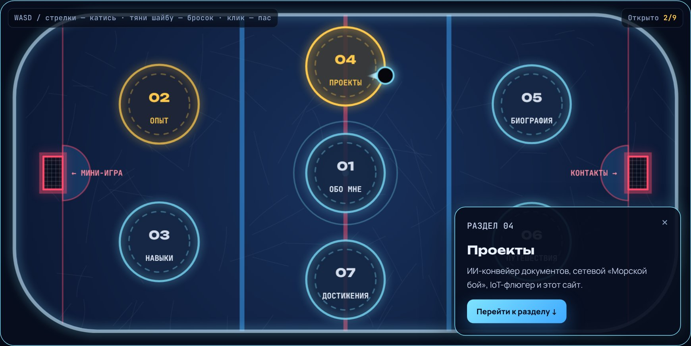
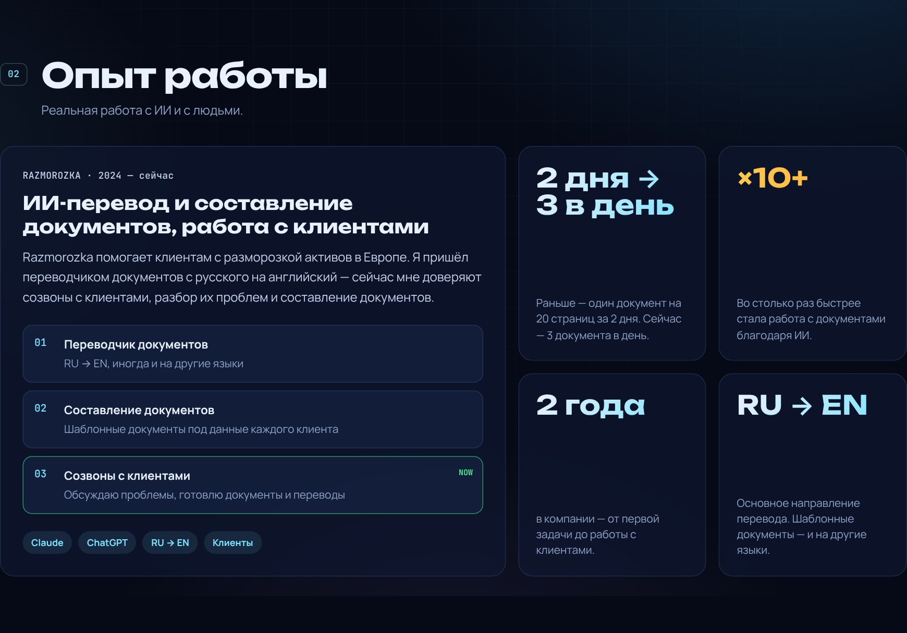
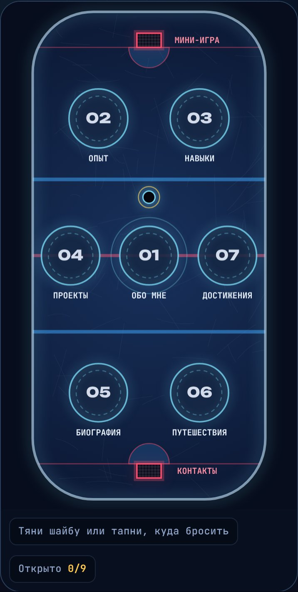

# kuzm1n-bigbob.ru

Персональный сайт-резюме в виде хоккейной площадки. Вместо обычного меню — арена: шайбу можно катать по льду, а каждый круг открывает раздел сайта.

**Сайт:** [kuzm1n-bigbob.ru](https://kuzm1n-bigbob.ru)



## Особенности

- Арена на Canvas: инерция и трение шайбы, отскоки от бортов, девять кругов-разделов и двое ворот. На телефоне площадка становится вертикальной и управляется касанием.
- Два языка, RU и EN. Язык выбирается по настройкам браузера и переключается без перезагрузки.
- Режим «Без игры» — та же информация в виде обычного резюме.
- Достижения для посетителей, мини-игра «Буллиты» с сохранением рекорда и пасхалка.
- Без фреймворков и сборки: только HTML, CSS и JavaScript.

<p>
  
  
</p>

## Стек

HTML, CSS, JavaScript (ES-модули), Canvas 2D, Web Audio API, IntersectionObserver, localStorage. Шрифты — Google Fonts. Хостинг — Рег.ру, сертификат — Let's Encrypt.

## Запуск

Скрипты подключены как ES-модули, поэтому сайт нужно открывать через локальный сервер, а не двойным кликом по `index.html`:

```bash
git clone https://github.com/kis1mik1/kuzm1n-bigbob.git
cd kuzm1n-bigbob
python -m http.server 8000
```

После этого сайт доступен на http://localhost:8000.

## Структура

```
.
├── index.html
├── assets/
│   ├── css/
│   │   └── style.css
│   ├── img/
│   │   ├── favicon.svg
│   │   └── photo.jpg
│   └── js/
│       ├── main.js        точка входа: инициализация и обработчики
│       ├── i18n.js        тексты RU/EN и переключение языка
│       ├── content.js     данные разделов: навыки, проекты, биография, страны
│       ├── render.js      заполнение разделов из данных
│       ├── arena.js       арена: физика шайбы и отрисовка
│       ├── shootout.js    мини-игра «Буллиты»
│       ├── badges.js      достижения посетителя
│       ├── card.js        карточка игрока
│       ├── sound.js       звуки через Web Audio API
│       ├── storage.js     обёртка над localStorage
│       ├── icons.js       SVG-иконки
│       └── dom.js         общие хелперы
├── docs/screenshots/
└── .github/workflows/
    └── deploy.yml
```

Тексты и данные отделены от логики: чтобы поменять описание или добавить проект, достаточно отредактировать `i18n.js` или `content.js`.

## Деплой

При пуше в `main` GitHub Actions загружает `index.html` и папку `assets` на хостинг по FTP. Для этого в настройках репозитория нужны секреты `FTP_SERVER`, `FTP_USERNAME` и `FTP_PASSWORD`. Если секретов нет, шаг загрузки пропускается.

## Лицензия

Код — [MIT](LICENSE). Тексты и фотографии принадлежат автору.
